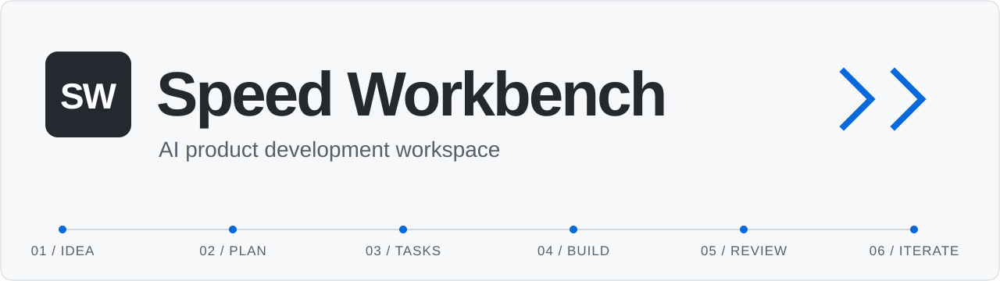
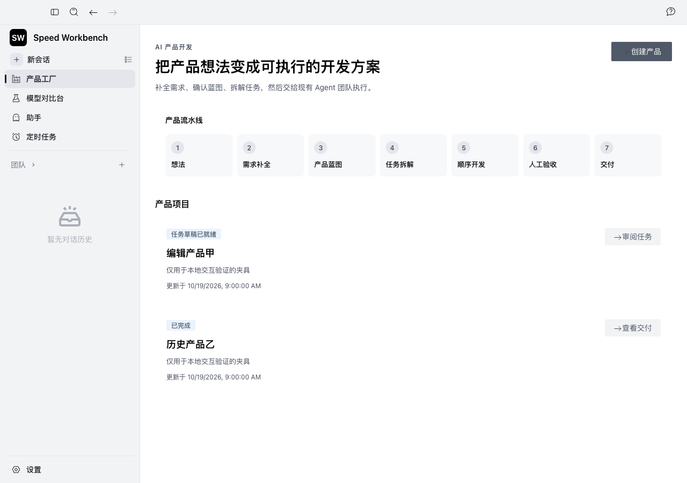

<p align="center">
  <picture>
    <source media="(prefers-color-scheme: dark)" srcset="docs/assets/readme/hero-dark.svg">
    
  </picture>
</p>

<h1 align="center">从产品想法，到可执行的开发方案。</h1>

<p align="center">
  <strong>面向产品经理与独立开发者的 AI 产品开发工作台</strong><br>
  梳理需求、确认蓝图、推进开发、人工审核，在一个工作空间中持续迭代。
</p>

<p align="center">
  <a href="https://github.com/26YZT/speed-workbench/actions/workflows/ci.yml"></a>
  <br>
  <code>Rust</code> <code>TypeScript</code> <code>Electron</code> <code>Bun</code>
</p>

<p align="center">
  <a href="#快速开始"><strong>快速开始</strong></a> ·
  <a href="#工作台能做什么">核心能力</a> ·
  <a href="#近期更新">近期更新</a> ·
  <a href="docs/guides/源码开发与打包.md">开发文档</a> ·
  <a href="https://github.com/26YZT/speed-workbench/issues">反馈问题</a>
</p>

---

## 为产品开发而设计

Speed Workbench 把需求、任务、执行记录、审核结果和代码版本围绕同一个产品组织起来。你可以从一个尚未完整的想法出发，逐步补全目标用户、核心问题和约束，确认方案后，再交给已配置的模型与编码助手参与实现。

**你确认方向与关键决策，工作台帮助组织规划、开发和迭代。**

<p align="center">
  <picture>
    <source media="(prefers-color-scheme: dark)" srcset="docs/assets/readme/product-factory-dark.png">
    
  </picture>
</p>

<p align="center"><sub>2026-10-19 本地桌面应用实拍；画面中的产品为交互验证样例。</sub></p>

## 工作台能做什么

| 工作区域 | 适合完成的事 |
| :--- | :--- |
| **产品工厂** | 从想法、需求访谈、产品蓝图和任务拆解，推进到开发、人工验收与交付 |
| **模型对比台** | 在同一输入与材料下比较所选模型的回答，保存输入、配置与已有结果 |
| **助手与会话** | 使用已配置的助手处理任务，围绕工作目标持续交流 |
| **团队与任务** | 组织开发任务、查看执行与复核记录，处理返工和显式继续 |
| **用量与预算** | 查看调用用量与计价信息，校验预算输入，并在费用状态不明时保留相应门禁 |
| **代码版本** | 保存选定代码的快照，以独立工作版本继续迭代；业务数据按应用自身约定管理 |

### 产品工厂的工作路径


需求、任务和验收由你确认。模型调用与编码执行需要自行配置相应服务；工作台不会提供模型账号、密钥或额度。

## 近期更新

| 时间 | 更新内容 |
| :--- | :--- |
| **2026-10-21** | 将最新开发源码同步到公开仓库，整理使用入口、项目状态和验证记录 |
| **2026-10-20** | 执行中断恢复、任务认领与人工复核并发校验、终态写入约束、访谈原子保存、交付成本门禁及产品工厂目录归属校验 |
| **2026-10-19** | 草稿恢复与未保存提示、独立的新产品草稿、完整历史产品入口、预算校验、阶段操作文案、键盘交互及内置示例品牌修复 |
| **2026-10-18** | 产品工厂、模型对比台、助手、定时任务使用同级导航，修正选中态与窄屏流水线布局 |

详见 [本次源码更新与验证](docs/RELEASE_NOTES.md) · [开发状态与验证边界](docs/STATUS.md)。

> 当前以本地使用和源码开发为主。公开源码已包含 10 月 20 日的改动；维护者本地桌面包仍为 10 月 19 日版本。本次不发布正式安装包。远程多用户的完整文件与进程隔离仍需建设和验证，暂不作为严格隔离的共享服务部署。

## 快速开始

### 1. 准备环境

| 工具 | 要求 |
| :--- | :--- |
| Rust | **1.95.0**，由仓库工具链配置固定 |
| Node.js | **22～24** |
| Bun | 安装前端依赖与启动开发环境 |
| 原生编译工具 | Python 3.11+，macOS 使用 Xcode Command Line Tools；其他平台使用对应编译工具 |
| 模型与编码助手 | 自行安装并配置所需服务或 CLI |

### 2. 安装与启动

macOS / Linux：

```bash
git clone https://github.com/26YZT/speed-workbench.git
cd speed-workbench/AionCore
cargo build --locked --bin aioncore

cd ../AionUi
bun install --frozen-lockfile
AIONUI_BACKEND_BIN="../AionCore/target/debug/aioncore" bun run start
```

桌面开发启动会启动指定后端，无需再启动一个使用相同数据目录的后端实例。平台差异、完整后端资源准备和桌面打包方式，见 [源码开发与打包](docs/guides/源码开发与打包.md)。

### 3. 创建第一个产品

进入 **「产品工厂 → 创建产品」**，从一个具体需求开始：

```text
产品名称：访谈摘要助手
目标用户：需要整理用户访谈的产品经理
解决的问题：访谈资料分散，需求提取与归类耗时
产品想法：输入访谈文本，生成摘要、需求列表和待确认问题
预期输出：可本地运行、支持保存历史结果的 Web 应用
约束条件：使用已配置的模型服务，保留人工确认环节
```

先补全需求，再确认蓝图和任务，按阶段推进。可以随时从产品列表回到对应项目；新产品草稿与已有产品分别保存。

## 文档与参与

| 文档 | 内容 |
| :--- | :--- |
| [源码开发与打包](docs/guides/源码开发与打包.md) | 环境准备、启动命令、后端资源与桌面分发 |
| [近期更新与验证](docs/RELEASE_NOTES.md) | 本次同步范围、检查结果与尚未验证的部分 |
| [项目状态](docs/STATUS.md) | 当前边界及带日期的历史验收记录 |
| [模型对比台指南](AionUi/docs/guides/model-bench.zh-CN.md) | 配置、输入材料和对比使用方式 |
| [贡献指南](AionUi/CONTRIBUTING.md) | 代码规范、测试及提交约定 |
| [问题反馈](https://github.com/26YZT/speed-workbench/issues) | 使用问题、复现步骤与功能建议 |

<details>
<summary><strong>项目结构与验证命令</strong></summary>

```text
speed-workbench/
├── AionCore/    Rust 后端、任务执行与数据持久化
├── AionUi/      Electron 桌面界面、前端交互与开发工具
└── docs/        使用指南、更新说明与历史验证证据
```

```bash
# 后端，需要 just 和 cargo-nextest
cd AionCore
just migration-check-test
just check

# 前端
cd ../AionUi
just check
bun run test --maxWorkers=2
```

GitHub Actions 分别检查前后端源码，不自动发布桌面安装包。完整命令及环境说明见开发文档。

</details>

---

<p align="center">
  <strong>Speed Workbench</strong><br>
  产品设计、定制开发与维护：<a href="https://github.com/26YZT">张岩（26YZT）</a><br>
  <a href="LICENSE">许可证</a> · <a href="NOTICE">版权与第三方声明</a> · <a href="docs/AUTHORS.md">作者信息</a>
</p>

基于 AionUi / AionCore 开源基础构建，保留上游及第三方的来源与许可。模块许可：[AionUi LICENSE](AionUi/LICENSE) · [AionCore LICENSE](AionCore/LICENSE)。
